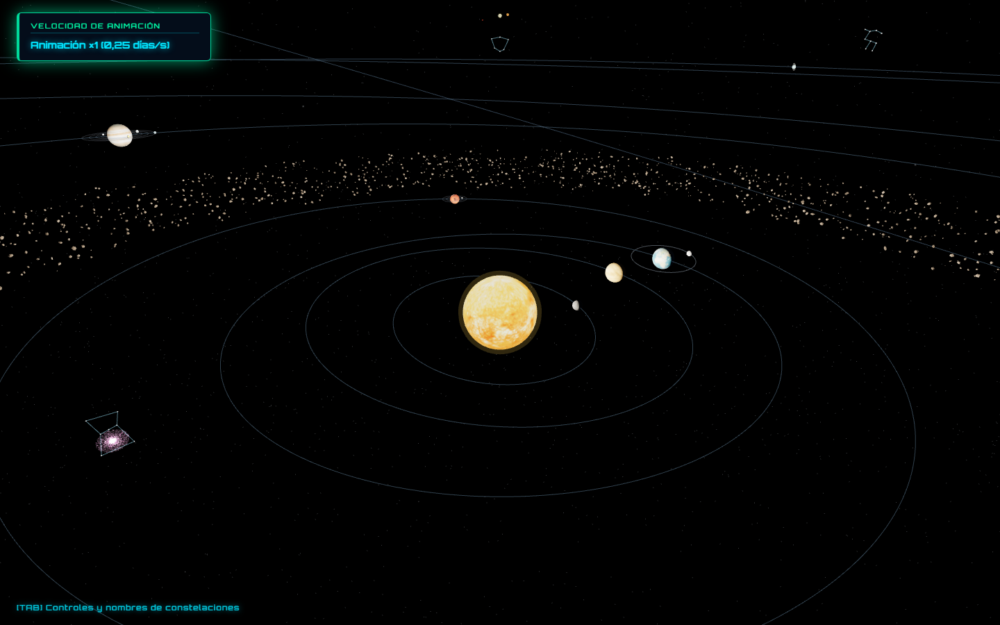
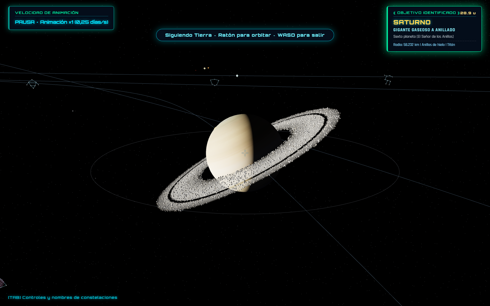
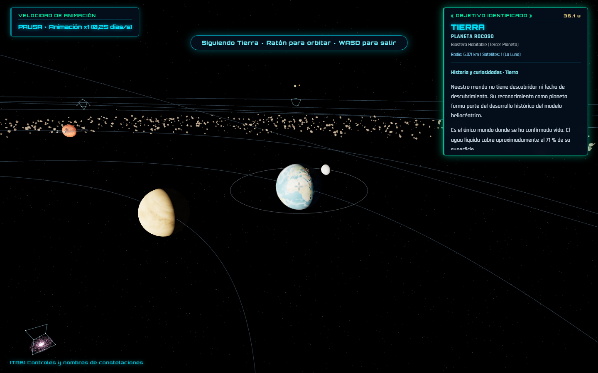
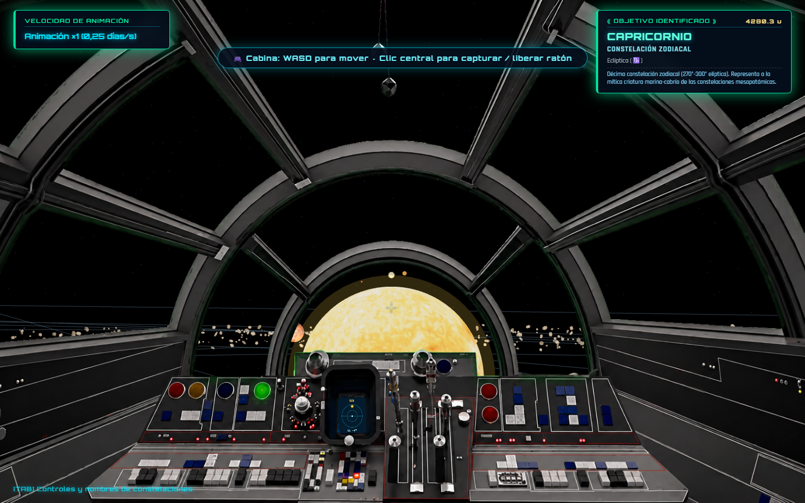

# Práctica 6 · Simulación interactiva del Sistema Solar

## Índice

- [1. Autoría](#1-autoría)
- [2. Estructura del proyecto](#2-estructura-del-proyecto)
  - [2.1. Puesta en marcha de la simulación](#21-puesta-en-marcha)
- [3. Controles de la simulación](#3-controles-de-la-simulación)
  - [3.1. Vídeo de demostración](#31-ver-vídeo-de-demostración)
- [4. Elaboración e implementación](#4-elaboración-e-implementación)
  - [4.1. Escena y organización jerárquica](#41-escena-y-organización-jerárquica)
  - [4.2. Materiales, iluminación y texturas](#42-materiales-iluminación-y-texturas)
  - [4.3. Órbitas y animación temporal](#43-órbitas-y-animación-temporal)
  - [4.4. Cámaras, seguimiento y selección](#44-cámaras-seguimiento-y-selección)
  - [4.5. Colisiones durante la navegación](#45-colisiones-durante-la-navegación)
  - [4.6. Entorno espacial y cabina](#46-entorno-espacial-y-cabina)
  - [4.7. Comprobaciones y alcance del modelo](#47-comprobaciones-y-alcance-del-modelo)
- [5. Conclusión](#5-conclusión)
- [6. Referencias bibliográficas y fuentes utilizadas](#6-referencias-bibliográficas-y-fuentes-utilizadas)

## 1. Autoría

**Autor: Néstor J. Henríquez Medina [(GitHub)](https://github.com/NestorJHM)**  
Asignatura: **Informática Gráfica**.  
Escuela de Ingeniería Informática, Universidad de Las Palmas de Gran Canaria.

El proyecto consiste en una escena tridimensional desarrollada con JavaScript, Three.js y WebGL. Permite explorar el sistema solar, observar el movimiento de los cuerpos celestes y navegar desde una cabina inspirada en el Halcón Milenario. La práctica aplica transformaciones geométricas, jerarquías de objetos, iluminación, texturas, cámaras y animación en tiempo real.

## 2. Estructura del proyecto

```text
PRACTICA-6/
├── index.html                 # Redirección a la aplicación de src/
├── README.md                 # Memoria de la práctica
├── src/
│   ├── index.html             # Página de entrada e importación de Three.js
│   ├── styles.css             # Estilos utilizados por la aplicación
│   ├── sistema_solar.js       # Escena, cámaras, controles y animación
│   ├── orbitas.js             # Elementos orbitales y ecuación de Kepler
│   ├── efecto-velocidad.js    # Túnel y estelas de W + Shift
│   ├── cosmos.js              # Estrellas, nebulosas, asteroides y efectos
│   ├── objetivos.js           # Detección de objetivos y destinos
│   ├── colisiones.js          # Detección y resolución de colisiones
│   └── planetas-info.js       # Información histórica y curiosidades
├── img/                       # Texturas de los cuerpos celestes y la cabina
│   └── PLANET_TEXTURES.md     # Procedencia y licencia de mapas planetarios
├── docs/
│   └── capturas/              # Capturas reales y vídeo de validación
└── tests/
    ├── orbitas.test.cjs       # Comprobaciones de los cálculos orbitales
    ├── colisiones.test.cjs    # Comprobaciones de contactos y deslizamiento
    ├── simulacion.test.cjs    # Comprobaciones de la lógica de la aplicación
    └── navegador.cjs          # Chromium real y capturas de la distribución
```

El módulo principal, `sistema_solar.js`, coordina la construcción y actualización de la escena. Los cálculos orbitales y las colisiones se separan de la representación gráfica, mientras que `cosmos.js` concentra la creación del entorno espacial.
### 2.1. Puesta en marcha
Para **ejecutar la simulación** se puede iniciar un servidor HTTP desde la raíz del proyecto:

```powershell
python -m http.server 8000 --bind 127.0.0.1
```

La aplicación queda disponible en [http://127.0.0.1:8000/src/](http://127.0.0.1:8000/src/). Se necesita un navegador con WebGL y conexión a Internet para cargar Three.js 0.152.1 y las tipografías externas. El HTML debe abrirse a través del servidor para permitir la carga de los módulos JavaScript.

## 3. Controles de la simulación

La aplicación comienza en **vista libre**, con las instrucciones y los nombres de constelaciones visibles. La tecla `V` permite alternar entre esta vista y la **cabina**.

| Control común | Acción |
| --- | --- |
| `W` / `S` | Avanzar / retroceder. |
| `A` / `D` | Desplazarse lateralmente. |
| Clic central | Activar/desactivar vista con el ratón para controlar la orientación. |
| `V` | Alternar entre vista libre y cabina. |
| `T` | Mostrar u ocultar la mira y la identificación de objetivos. |
| `Z` o clic derecho | Alternar el zoom entre ×1, ×2, ×4 y ×8. |
| `Tab` | Mostrar u ocultar las instrucciones y los nombres de las constelaciones. |
| `F` | Ocultar o recuperar la información, las miras y los rótulos. Las instrucciones se muestran u ocultan únicamente con Tab. |
| `F11` o botón de pantalla completa | Entrar o salir de pantalla completa. |

En **vista libre**, `Alt` reduce la velocidad de desplazamiento, `Shift` la aumenta y `Alt` + `Shift` permite recorrer grandes distancias. Un doble clic izquierdo sobre un planeta, satélite o estrella activa su seguimiento; el ratón permite orbitar alrededor del cuerpo. Pulsar WASD cancela el seguimiento.

En **cabina**, la orientación se controla con el ratón capturado o arrastrando con el botón izquierdo. La combinación `W` + `Shift` activa hipervelocidad de hasta 650 unidades/s mientras se mantienen ambas teclas. Al soltar Shift se recupera el vuelo normal de 15 unidades/s, con aceleración progresiva. El radar del salpicadero señala la dirección del Sol respecto a la nave. El doble clic no activa el seguimiento en esta vista.

El ritmo de los movimientos orbitales se controla de forma independiente al desplazamiento de la cámara:

| Tecla | Modo temporal |
| --- | --- |
| `1`, `2`, `3`, `4`, `5` | Animación a ×1, ×2, ×4, ×8 y ×16, respectivamente. |
| `0` | Tiempo real: un segundo simulado por segundo transcurrido. |
| `P` | Pausar o reanudar la dinámica de los cuerpos celestes. |

El modo inicial ×1 representa 0,25 días por segundo; por tanto, ×4 representa un día por segundo. Elegir una velocidad o el tiempo real también reanuda la dinámica. La pausa permite seguir explorando la escena; el efecto de hipervelocidad sigue respondiendo a W + Shift.

La captura del puntero y la protección de los atajos reservados del navegador dependen de la compatibilidad del navegador con las API de bloqueo del ratón y del teclado.

### 3.1. [Ver vídeo de demostración](https://youtu.be/vOr3JK-TqUs)

## 4. Elaboración e implementación

### 4.1. Escena y organización jerárquica

La construcción parte de una `THREE.Scene`, dos cámaras de perspectiva y un renderizador WebGL. Una cámara corresponde al vuelo libre y otra a la cabina. El renderizador dibuja la escena desde la cámara activa en cada fotograma.

El sistema solar se organiza en grupos. Dentro de cada sistema planetario se distinguen la posición orbital, la inclinación del eje y la malla del planeta. Los satélites tienen sus propios pivotes, de modo que acompañan la traslación del planeta y conservan su movimiento local. Esta jerarquía permite combinar traslación, rotación e inclinación sin tener que recalcular manualmente todas las transformaciones.

Por ejemplo, `crearTierraYLuna()` construye el eje terrestre y añade la superficie como objeto hijo:

```javascript
const earthAxisGroup = new THREE.Group();
earthAxisGroup.rotation.z = THREE.MathUtils.degToRad(23.44);
earthSystem.add(earthAxisGroup);

const earthGeo = new THREE.SphereGeometry(2.3, 64, 64);
```

La Luna se incorpora al grupo terrestre mediante otro pivote. Los anillos de Saturno y Urano se asocian al grupo de inclinación axial de sus respectivos planetas.


 **Figura 1. Vista general del sistema solar.**  


### 4.2. Materiales, iluminación y texturas

Los cuerpos se modelan principalmente mediante esferas. La iluminación combina una componente ambiental y una luz puntual situada en el Sol. Las superficies utilizan mapas de imagen para distinguir los planetas; también se generan texturas procedurales como alternativa para los mapas configurados de esa forma.

La Tierra combina un mapa de color, uno de relieve y otro especular. En `crearTierraYLuna()` se configura el siguiente material:

```javascript
const earthMat = new THREE.MeshPhongMaterial({
  map: earthMap,
  bumpMap: earthBump,
  bumpScale: 0.06,
  specularMap: earthSpec,
  specular: new THREE.Color(0x354455),
  shininess: 25
});
```

El mapa de relieve modifica la respuesta a la luz sin aumentar la geometría de la esfera. El mapa especular permite variar los reflejos según la superficie. Las nubes se dibujan sobre una segunda esfera ligeramente mayor, con transparencia y una rotación diferenciada.



 **Figura 2. Detalle de Saturno y sus anillos de asteroides.**  

### 4.3. Órbitas y animación temporal

El módulo [orbitas.js](src/orbitas.js) almacena los elementos orbitales y calcula las posiciones mediante una aproximación kepleriana. `resolverKepler()` resuelve la ecuación `M = E − e · sin(E)` por iteración de Newton-Raphson. A continuación, `posicionOrbital()` calcula un punto de la elipse y aplica su orientación espacial.

La función que reúne ambos cálculos es:

```javascript
export function posicionEnDias(elementos, dias) {
  const m = (elementos[3] - elementos[4]) * rad + dias * 2 * Math.PI / elementos[6];
  return posicionOrbital(elementos, resolverKepler(m, elementos[1]));
}
```

El vector de elementos contiene el semieje mayor, la excentricidad, la inclinación, la longitud media, la longitud del perihelio, el nodo y el periodo. La posición se transforma al plano XZ de Three.js, con una escala de 45 unidades por unidad astronómica. Los elementos de los planetas toman como referencia J2000; Plutón utiliza los datos indicados en el propio módulo.

`actualizarDinamica()` acumula los días simulados y actualiza la traslación de cada planeta. La rotación propia se calcula a partir de su periodo en horas, y los satélites utilizan sus respectivos periodos orbitales. Las lunas siguen recorridos circulares simplificados.

El bucle `animate()` solicita el siguiente fotograma con `requestAnimationFrame()`, actualiza dinámica, navegación, efectos e interfaz y termina con `renderer.render(scene, activeCamera)`. La dinámica recibe el tiempo completo transcurrido; los controles utilizan un incremento limitado a 0,1 segundos para evitar desplazamientos bruscos tras una interrupción.

### 4.4. Cámaras, seguimiento y selección

`actualizarCamaraGeneral()` convierte las entradas de teclado en desplazamientos respecto a la orientación de la cámara. El giro se suaviza mediante un factor exponencial dependiente del tiempo entre fotogramas:

```javascript
const blend = 1 - Math.exp(-GENERAL_SMOOTHING * delta);
const mouseX = generalMousePending.x * blend;
const mouseY = generalMousePending.y * blend;
generalMousePending.multiplyScalar(1 - blend);
```

Este cálculo reparte el movimiento pendiente y reduce la dependencia de la respuesta respecto a la tasa de fotogramas. El seguimiento mantiene un cuerpo como centro de observación, mientras que la vista de cabina aplica la posición y orientación de la nave a su cámara.

La función `detectarObjetivo()`, en [objetivos.js](src/objetivos.js), proyecta las posiciones de los cuerpos a coordenadas de pantalla y compara su distancia a la mira. El objetivo detectado alimenta el panel informativo y la selección de destinos. El doble clic utiliza una comprobación mediante rayos para elegir el cuerpo que se desea seguir. Las fichas de `planetas-info.js` añaden datos históricos y curiosidades de los planetas.



**Figura 3. Seguimiento de un planeta.**  

### 4.5. Colisiones durante la navegación

El módulo [colisiones.js](src/colisiones.js) aproxima al explorador mediante una esfera pequeña y comprueba su recorrido frente a los cuerpos esféricos registrados. `resolverColisiones()` examina el segmento entre la posición inicial y la final, considerando también el movimiento de los cuerpos. Así se detectan impactos aunque un desplazamiento rápido atraviese una superficie entre dos fotogramas.

Tras corregir la posición, `actualizarColisiones()` elimina la componente de velocidad que apunta hacia el interior:

```javascript
const inwardSpeed = ship.velocity.dot(contact.normal);
if (inwardSpeed < 0) ship.velocity.addScaledVector(contact.normal, -inwardSpeed);
```

El producto escalar permite separar la componente normal de la tangencial. Al conservar esta última, la nave puede deslizarse por la superficie. Las colisiones permanecen activas durante toda la navegación.

### 4.6. Entorno espacial y cabina

El módulo [cosmos.js](src/cosmos.js) construye estrellas y nebulosas mediante nubes de puntos. El cinturón de asteroides utiliza 2.400 instancias y los anillos de Saturno incorporan 6.000 fragmentos. `THREE.InstancedMesh` permite compartir geometría y material entre fragmentos con transformaciones distintas, reduciendo las llamadas de dibujo frente a una malla independiente por objeto.

La cabina combina la escena 3D con una imagen superpuesta. Al mantener W + Shift, un túnel de luz procedural y estelas acompañan a la cámara; se desvanecen durante unos 1,4 segundos al soltar cualquiera de esas teclas. Las 3.000 estelas son casi blancas y el túnel no tiene bandas azules en espiral. Al cambiar a vista general se oculta todo el efecto. El radar transforma la dirección del Sol a los ejes locales de la nave mediante la rotación inversa de la cámara; así puede indicar su dirección y elevación aunque cambie la orientación de vuelo.



**Figura 4. Interior de cabina del Halcón Milenario.**  

### 4.7. Comprobaciones y alcance del modelo

El proyecto requiere Node.js 22 o posterior y usa `npm ci` para instalar las versiones fijadas. `npm start` sirve la aplicación compilada con esbuild; `npm run build` genera una distribución autocontenida en `dist/`. El proyecto incluye pruebas para los cálculos orbitales, las colisiones y la lógica de la simulación. Con Node.js y las dependencias instaladas, se ejecutan mediante `npm test`. Estas comprobaciones cubren aspectos como el cierre de las órbitas y los impactos a gran velocidad. Las pruebas de integración utilizan un entorno de representación simulado, y se complementan con `npm run test:browser`: Chromium real, WebGL, carga de recursos, controles, vuelo lento a 15 unidades/s y W + Shift hasta 650 unidades/s y seguimiento. Las capturas y el vídeo se regeneran con esta prueba.

Las distancias orbitales siguen una escala común, pero los radios de los cuerpos y las separaciones entre sistemas se adaptan para facilitar la observación. El modelo no incorpora perturbaciones gravitatorias ni una integración de múltiples cuerpos. Las constelaciones y las nebulosas son representaciones ilustrativas; la velocidad denominada «de la luz» en los controles es una velocidad de navegación de la escena.

## 5. Conclusión

La práctica integra los principales elementos de una aplicación gráfica interactiva: construcción de geometría, transformaciones jerárquicas, materiales, iluminación, cámaras y actualización temporal. La organización de planetas y satélites permite combinar movimientos locales y globales, mientras que la separación entre cálculo orbital y representación facilita comprender cómo se obtiene la animación.

El vuelo libre permite observar los cuerpos con detalle y la cabina añade una forma de exploración basada en orientación, aceleración y referencias visuales. El seguimiento, la información planetaria y el control temporal completan la interacción. El resultado es una representación educativa del sistema solar, con simplificaciones de escala y dinámica que favorecen su exploración. Como posibles ampliaciones quedan el ajuste configurable de las escalas y la incorporación de modelos orbitales más precisos para los satélites.

## 6. Referencias bibliográficas y fuentes utilizadas

1. **Three.js y colaboradores.** [Documentación oficial](https://threejs.org/docs/). Referencia para escenas, cámaras, materiales, transformaciones e instanciación. La versión utilizada en el proyecto es la 0.152.1.
2. **NASA / JPL, Solar System Dynamics.** [Approximate Positions of the Planets](https://ssd.jpl.nasa.gov/planets/approx_pos.html). Elementos orbitales y formulación del cálculo aproximado de posiciones, utilizados como base en `orbitas.js`.
3. **NASA / JPL, Solar System Dynamics.** [Planetary Satellite Mean Elements](https://ssd.jpl.nasa.gov/sats/elem/). Referencia para periodos de satélites.
4. **NASA / JPL.** [Small-Body Database: 134340 Pluto](https://ssd-api.jpl.nasa.gov/sbdb.api?sstr=134340&full-prec=true). Fuente de los elementos de Plutón indicada en el código.
5. **NASA, National Space Science Data Center.** [Planetary Fact Sheet](https://nssdc.gsfc.nasa.gov/planetary/factsheet/). Referencia de propiedades planetarias y periodos de rotación.
6. **NASA / JPL, Solar System Dynamics.** [Planetary Discovery Circumstances](https://ssd.jpl.nasa.gov/planets/discovery.html), y **NASA Science**, [Solar System Exploration](https://science.nasa.gov/solar-system/). Fuentes de descubrimientos y datos divulgativos; las fichas de `planetas-info.js` incluyen los enlaces de cada planeta.
7. **Solar System Scope / INOVE.** [Solar Textures](https://www.solarsystemscope.com/textures/). Mapas de Mercurio, Venus, Marte, Júpiter, Saturno, Urano y Neptuno, bajo licencia CC BY 4.0. La atribución y los archivos correspondientes se detallan en [img/PLANET_TEXTURES.md](img/PLANET_TEXTURES.md).
8. **MDN Web Docs.** [Pointer Lock API](https://developer.mozilla.org/en-US/docs/Web/API/Pointer_Lock_API) y [Keyboard: lock()](https://developer.mozilla.org/en-US/docs/Web/API/Keyboard/lock). Documentación de las API empleadas para la captura de entradas.

Las tipografías de la interfaz son **Orbitron** y **Rajdhani**, cargadas desde Google Fonts. Los mapas terrestres y la imagen de cabina son recursos preexistentes del proyecto cuya procedencia no se especifica en los archivos de créditos disponibles; la atribución a Solar System Scope incluye los siete mapas planetarios y el Sol, cuya procedencia se ha verificado mediante SHA-256. El inventario y las huellas de todos los recursos originales figuran en [img/ORIGINAL_RESOURCES.md](img/ORIGINAL_RESOURCES.md); se ha identificado la procedencia de distribución de la Luna y siguen pendientes los mapas terrestres y la cabina.
